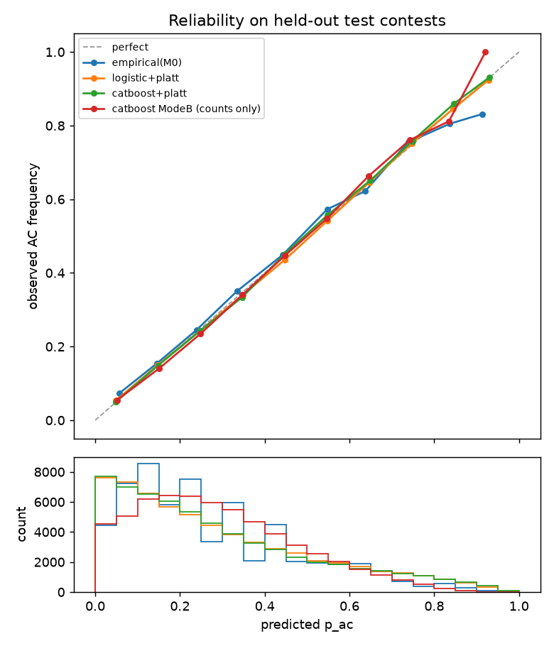

# Evaluation report

- Data version (xcpcio/board-data commit): `9075040bc9f190e3faa01ecca859bae428b1fc5f`
- Seed: `20261108`; reproduce with: `xcpcpredict experiment`
- Rows (team × problem × observation time): 330114 from 164 contests (tiers ['A', 'B']), positive rate 0.282
- Time split by whole contests: train 106 contests / 229061 rows (2017-04-22 … 2024-11-24), val 25 / 40472 (2024-12-01 … 2025-11-15), test 33 / 60581 (2025-11-16 … 2026-11-08)
- Calibration chosen by 2-fold contest cross-fit on val: {'logistic': 'platt', 'catboost': 'platt'}

## Held-out test contests

| model | n | base_rate | brier | logloss | ece | roc_auc | pr_auc | contest_mean_brier | contest_mean_logloss |
|---|---|---|---|---|---|---|---|---|---|
| prior | 60581 | 0.2853 | 0.2040 | 0.5980 | 0.0070 | 0.5000 | 0.2853 | 0.1980 | 0.5852 |
| empirical(M0) | 60581 | 0.2853 | 0.1672 | 0.5063 | 0.0124 | 0.7606 | 0.5615 | 0.1636 | 0.4977 |
| logistic | 60581 | 0.2853 | 0.1543 | 0.4712 | 0.0113 | 0.8010 | 0.6305 | 0.1516 | 0.4642 |
| catboost | 60581 | 0.2853 | 0.1514 | 0.4631 | 0.0073 | 0.8080 | 0.6447 | 0.1482 | 0.4549 |
| logistic+platt | 60581 | 0.2853 | 0.1541 | 0.4705 | 0.0050 | 0.8010 | 0.6305 | 0.1514 | 0.4633 |
| catboost+platt | 60581 | 0.2853 | 0.1513 | 0.4629 | 0.0044 | 0.8080 | 0.6447 | 0.1482 | 0.4546 |
| catboost ModeB (counts only) | 60581 | 0.2853 | 0.1685 | 0.5066 | 0.0080 | 0.7583 | 0.5549 | 0.1646 | 0.4969 |

`contest_mean_*` averages the metric per contest so large contests do not dominate.

### Contest-cluster bootstrap of differences (candidate − baseline; negative = candidate better)

| baseline | candidate | metric | delta | lo | hi | p_b_not_better |
|---|---|---|---|---|---|---|
| prior | empirical(M0) | brier | -0.0368 | -0.0418 | -0.0309 | 0.0000 |
| prior | empirical(M0) | logloss | -0.0917 | -0.1011 | -0.0804 | 0.0000 |
| empirical(M0) | logistic | brier | -0.0129 | -0.0147 | -0.0108 | 0.0000 |
| empirical(M0) | logistic | logloss | -0.0351 | -0.0402 | -0.0293 | 0.0000 |
| logistic | catboost | brier | -0.0029 | -0.0040 | -0.0017 | 0.0000 |
| logistic | catboost | logloss | -0.0081 | -0.0110 | -0.0049 | 0.0000 |
| empirical(M0) | catboost | brier | -0.0158 | -0.0176 | -0.0138 | 0.0000 |
| empirical(M0) | catboost | logloss | -0.0432 | -0.0474 | -0.0381 | 0.0000 |
| catboost | catboost+platt | brier | -0.0000 | -0.0002 | 0.0001 | 0.3220 |
| catboost | catboost+platt | logloss | -0.0003 | -0.0008 | 0.0003 | 0.1640 |
| catboost ModeB (counts only) | catboost+platt | brier | -0.0172 | -0.0193 | -0.0148 | 0.0000 |
| catboost ModeB (counts only) | catboost+platt | logloss | -0.0437 | -0.0484 | -0.0384 | 0.0000 |

### Reliability of the calibrated CatBoost (test)

| lo | hi | n | mean_p | frac_ac |
|---|---|---|---|---|
| 0.0000 | 0.1000 | 14700 | 0.0479 | 0.0491 |
| 0.1000 | 0.2000 | 12608 | 0.1488 | 0.1493 |
| 0.2000 | 0.3000 | 9913 | 0.2477 | 0.2428 |
| 0.3000 | 0.4000 | 7109 | 0.3469 | 0.3342 |
| 0.4000 | 0.5000 | 5151 | 0.4468 | 0.4506 |
| 0.5000 | 0.6000 | 3794 | 0.5484 | 0.5572 |
| 0.6000 | 0.7000 | 2979 | 0.6489 | 0.6509 |
| 0.7000 | 0.8000 | 2291 | 0.7483 | 0.7582 |
| 0.8000 | 0.9000 | 1529 | 0.8461 | 0.8594 |
| 0.9000 | 1.0000 | 507 | 0.9301 | 0.9310 |

### Confusion matrices at fixed thresholds (test; predict AC iff p_ac ≥ threshold)

The model's product is the probability; thresholds only illustrate the trade-off. With a ~28% base rate, accuracy of always predicting non-AC is the bar to beat for accuracy.

**catboost+platt**

| threshold | TP | FP | FN | TN | precision | recall | specificity | accuracy | f1 | predicted_ac_share |
|---|---|---|---|---|---|---|---|---|---|---|
| 0.200 | 14680 | 18593 | 2604 | 24704 | 0.441 | 0.849 | 0.571 | 0.650 | 0.581 | 0.549 |
| 0.300 | 12273 | 11087 | 5011 | 32210 | 0.525 | 0.710 | 0.744 | 0.734 | 0.604 | 0.386 |
| 0.400 | 9897 | 6354 | 7387 | 36943 | 0.609 | 0.573 | 0.853 | 0.773 | 0.590 | 0.268 |
| 0.500 | 7576 | 3524 | 9708 | 39773 | 0.683 | 0.438 | 0.919 | 0.782 | 0.534 | 0.183 |
| 0.600 | 5462 | 1844 | 11822 | 41453 | 0.748 | 0.316 | 0.957 | 0.774 | 0.444 | 0.121 |
| 0.700 | 3523 | 804 | 13761 | 42493 | 0.814 | 0.204 | 0.981 | 0.760 | 0.326 | 0.071 |

**logistic+platt**

| threshold | TP | FP | FN | TN | precision | recall | specificity | accuracy | f1 | predicted_ac_share |
|---|---|---|---|---|---|---|---|---|---|---|
| 0.200 | 14639 | 18790 | 2645 | 24507 | 0.438 | 0.847 | 0.566 | 0.646 | 0.577 | 0.552 |
| 0.300 | 12315 | 11552 | 4969 | 31745 | 0.516 | 0.713 | 0.733 | 0.727 | 0.599 | 0.394 |
| 0.400 | 9893 | 6852 | 7391 | 36445 | 0.591 | 0.572 | 0.842 | 0.765 | 0.581 | 0.276 |
| 0.500 | 7498 | 3755 | 9786 | 39542 | 0.666 | 0.434 | 0.913 | 0.776 | 0.525 | 0.186 |
| 0.600 | 5319 | 1916 | 11965 | 41381 | 0.735 | 0.308 | 0.956 | 0.771 | 0.434 | 0.119 |
| 0.700 | 3339 | 832 | 13945 | 42465 | 0.801 | 0.193 | 0.981 | 0.756 | 0.311 | 0.069 |

**empirical(M0)**

| threshold | TP | FP | FN | TN | precision | recall | specificity | accuracy | f1 | predicted_ac_share |
|---|---|---|---|---|---|---|---|---|---|---|
| 0.200 | 14204 | 20309 | 3080 | 22988 | 0.412 | 0.822 | 0.531 | 0.614 | 0.548 | 0.570 |
| 0.300 | 11533 | 12100 | 5751 | 31197 | 0.488 | 0.667 | 0.721 | 0.705 | 0.564 | 0.390 |
| 0.400 | 8712 | 6897 | 8572 | 36400 | 0.558 | 0.504 | 0.841 | 0.745 | 0.530 | 0.258 |
| 0.500 | 5770 | 3285 | 11514 | 40012 | 0.637 | 0.334 | 0.924 | 0.756 | 0.438 | 0.149 |
| 0.600 | 3604 | 1670 | 13680 | 41627 | 0.683 | 0.209 | 0.961 | 0.747 | 0.320 | 0.087 |
| 0.700 | 1596 | 452 | 15688 | 42845 | 0.779 | 0.092 | 0.990 | 0.734 | 0.165 | 0.034 |

**catboost ModeB (counts only)**

| threshold | TP | FP | FN | TN | precision | recall | specificity | accuracy | f1 | predicted_ac_share |
|---|---|---|---|---|---|---|---|---|---|---|
| 0.200 | 14984 | 23330 | 2300 | 19967 | 0.391 | 0.867 | 0.461 | 0.577 | 0.539 | 0.632 |
| 0.300 | 12093 | 13911 | 5191 | 29386 | 0.465 | 0.700 | 0.679 | 0.685 | 0.559 | 0.429 |
| 0.400 | 8633 | 7210 | 8651 | 36087 | 0.545 | 0.499 | 0.833 | 0.738 | 0.521 | 0.262 |
| 0.500 | 5500 | 3324 | 11784 | 39973 | 0.623 | 0.318 | 0.923 | 0.751 | 0.421 | 0.146 |
| 0.600 | 3000 | 1254 | 14284 | 42043 | 0.705 | 0.174 | 0.971 | 0.744 | 0.279 | 0.070 |
| 0.700 | 1271 | 375 | 16013 | 42922 | 0.772 | 0.074 | 0.991 | 0.729 | 0.134 | 0.027 |

### By data quality tier (calibrated CatBoost, test)

| tier | contests | n | base_rate | brier | logloss | roc_auc |
|---|---|---|---|---|---|---|
| A | 33 | 60581 | 0.2853 | 0.1513 | 0.4629 | 0.8080 |

### Per-contest Brier on test (calibrated CatBoost vs M0)

CatBoost better than M0 in 33 of 33 test contests; per-contest Brier range 0.108 – 0.180.

### Subgroups (test)

| subgroup | n | ac_rate | brier[M0] | mean_p[M0] | brier[LR] | mean_p[LR] | brier[CB] | mean_p[CB] |
|---|---|---|---|---|---|---|---|---|
| hidden=1 | 30532 | 0.3173 | 0.1769 | 0.3120 | 0.1607 | 0.3153 | 0.1579 | 0.3145 |
| hidden=2 | 13347 | 0.2935 | 0.1716 | 0.2905 | 0.1586 | 0.2942 | 0.1556 | 0.3017 |
| hidden>=3 | 16702 | 0.2202 | 0.1460 | 0.1975 | 0.1390 | 0.2145 | 0.1359 | 0.2195 |
| no pre-freeze attempt | 26549 | 0.2647 | 0.1532 | 0.2500 | 0.1365 | 0.2569 | 0.1330 | 0.2543 |
| pre-freeze WA>=2 | 24770 | 0.3006 | 0.1794 | 0.2929 | 0.1701 | 0.3058 | 0.1670 | 0.3128 |
| easy problem (solve rate>=0.6) | 32536 | 0.3516 | 0.1908 | 0.3440 | 0.1740 | 0.3573 | 0.1703 | 0.3474 |
| medium problem | 24788 | 0.2190 | 0.1448 | 0.2057 | 0.1357 | 0.2062 | 0.1340 | 0.2258 |
| hard problem (<0.25) | 3257 | 0.1277 | 0.1025 | 0.1260 | 0.0981 | 0.1224 | 0.0933 | 0.1215 |
| strong team (top 20%) | 12812 | 0.3604 | 0.1872 | 0.3505 | 0.1760 | 0.3690 | 0.1686 | 0.3644 |
| weak team (bottom 50%) | 29567 | 0.2418 | 0.1548 | 0.2413 | 0.1413 | 0.2376 | 0.1390 | 0.2428 |
| just submitted (age<5min) | 22819 | 0.1412 | 0.1163 | 0.1380 | 0.1102 | 0.1350 | 0.1083 | 0.1420 |
| silent >=20min | 15162 | 0.5088 | 0.2190 | 0.4736 | 0.1927 | 0.5105 | 0.1881 | 0.5037 |
| early freeze (obs_frac<=1/6) | 5616 | 0.2112 | 0.1593 | 0.2036 | 0.1543 | 0.2176 | 0.1515 | 0.2210 |
| end of contest (obs_frac=1) | 17156 | 0.2786 | 0.1442 | 0.2686 | 0.1247 | 0.2718 | 0.1208 | 0.2696 |

## Ablations (5-fold contest-grouped CV over all 164 contests)

Cumulative levels: M1 problem solve rate + team solved; M2 + dirt / penalty decomposition / pre-freeze cell history; M3 + hidden submission counts; M4 + hidden submission times and gaps; M5 + other-problem activity; M6 + difficulty of problems moved to, crowd behaviour on the same problem, problem trend before the freeze, medal-line distance, team groups, last-minute submissions. `minus X` drops a feature family from the full CatBoost model.

| variant | brier | logloss | ece | roc_auc | contest_mean_brier |
|---|---|---|---|---|---|
| M0 | 0.1632 | 0.4953 | 0.0018 | 0.7696 | 0.1630 |
| LR-M1 | 0.1792 | 0.5327 | 0.0048 | 0.7149 | 0.1790 |
| CB-M1 | 0.1781 | 0.5296 | 0.0099 | 0.7196 | 0.1784 |
| LR-M2 | 0.1758 | 0.5237 | 0.0071 | 0.7302 | 0.1757 |
| CB-M2 | 0.1748 | 0.5203 | 0.0082 | 0.7339 | 0.1743 |
| LR-M3 | 0.1693 | 0.5085 | 0.0019 | 0.7531 | 0.1696 |
| CB-M3 | 0.1653 | 0.4973 | 0.0020 | 0.7664 | 0.1652 |
| LR-M4 | 0.1525 | 0.4669 | 0.0112 | 0.8029 | 0.1525 |
| CB-M4 | 0.1487 | 0.4549 | 0.0031 | 0.8136 | 0.1481 |
| LR-M5 | 0.1513 | 0.4636 | 0.0087 | 0.8058 | 0.1514 |
| CB-M5 | 0.1480 | 0.4534 | 0.0030 | 0.8151 | 0.1475 |
| LR-M6 | 0.1503 | 0.4598 | 0.0052 | 0.8093 | 0.1505 |
| CB-M6 | 0.1476 | 0.4521 | 0.0030 | 0.8163 | 0.1473 |
| LR-M7 | 0.1498 | 0.4582 | 0.0048 | 0.8111 | 0.1500 |
| CB-M7 | 0.1474 | 0.4514 | 0.0027 | 0.8171 | 0.1469 |
| CB-M7 minus dirt/first-try rates | 0.1480 | 0.4531 | 0.0024 | 0.8153 | 0.1477 |
| CB-M7 minus penalty decomposition | 0.1472 | 0.4509 | 0.0027 | 0.8175 | 0.1468 |
| CB-M7 minus hidden submission counts | 0.1474 | 0.4518 | 0.0022 | 0.8167 | 0.1469 |
| CB-M7 minus submission gaps | 0.1475 | 0.4516 | 0.0031 | 0.8168 | 0.1469 |
| CB-M7 minus silence since last submission | 0.1480 | 0.4529 | 0.0023 | 0.8155 | 0.1477 |
| CB-M7 minus other-problem activity | 0.1478 | 0.4526 | 0.0020 | 0.8161 | 0.1473 |
| CB-M7 minus M6 moved-to problems | 0.1473 | 0.4513 | 0.0031 | 0.8173 | 0.1468 |
| CB-M7 minus M6 crowd behaviour | 0.1474 | 0.4516 | 0.0024 | 0.8171 | 0.1469 |
| CB-M7 minus M6 problem trend | 0.1475 | 0.4517 | 0.0022 | 0.8167 | 0.1470 |
| CB-M7 minus M6 medal distance | 0.1475 | 0.4516 | 0.0025 | 0.8169 | 0.1469 |
| CB-M7 minus M6 team groups | 0.1474 | 0.4514 | 0.0024 | 0.8171 | 0.1469 |
| CB-M7 minus M6 last minutes | 0.1473 | 0.4510 | 0.0024 | 0.8176 | 0.1468 |

### Bootstrap of Brier change (to − from; negative = `to` better)

| from | to | brier_delta | ci_lo | ci_hi |
|---|---|---|---|---|
| M0 | CB-M1 | 0.0149 | 0.0130 | 0.0167 |
| CB-M1 | CB-M2 | -0.0033 | -0.0045 | -0.0021 |
| CB-M2 | CB-M3 | -0.0095 | -0.0103 | -0.0087 |
| CB-M3 | CB-M4 | -0.0166 | -0.0175 | -0.0155 |
| CB-M4 | CB-M5 | -0.0006 | -0.0009 | -0.0004 |
| CB-M5 | CB-M6 | -0.0004 | -0.0009 | -0.0001 |
| CB-M6 | CB-M7 | -0.0002 | -0.0005 | 0.0001 |
| LR-M1 | LR-M2 | -0.0034 | -0.0041 | -0.0027 |
| LR-M2 | LR-M3 | -0.0065 | -0.0071 | -0.0058 |
| LR-M3 | LR-M4 | -0.0168 | -0.0178 | -0.0158 |
| LR-M4 | LR-M5 | -0.0011 | -0.0013 | -0.0010 |
| LR-M5 | LR-M6 | -0.0010 | -0.0014 | -0.0007 |
| LR-M6 | LR-M7 | -0.0005 | -0.0008 | -0.0002 |
| CB-M7 minus dirt/first-try rates | CB-M7 | -0.0006 | -0.0009 | -0.0003 |
| CB-M7 minus penalty decomposition | CB-M7 | 0.0002 | -0.0000 | 0.0005 |
| CB-M7 minus hidden submission counts | CB-M7 | -0.0000 | -0.0003 | 0.0002 |
| CB-M7 minus submission gaps | CB-M7 | -0.0001 | -0.0003 | 0.0002 |
| CB-M7 minus silence since last submission | CB-M7 | -0.0006 | -0.0008 | -0.0004 |
| CB-M7 minus other-problem activity | CB-M7 | -0.0004 | -0.0006 | -0.0001 |
| CB-M7 minus M6 moved-to problems | CB-M7 | 0.0001 | -0.0001 | 0.0003 |
| CB-M7 minus M6 crowd behaviour | CB-M7 | -0.0000 | -0.0002 | 0.0002 |
| CB-M7 minus M6 problem trend | CB-M7 | -0.0001 | -0.0004 | 0.0002 |
| CB-M7 minus M6 medal distance | CB-M7 | -0.0001 | -0.0003 | 0.0002 |
| CB-M7 minus M6 team groups | CB-M7 | 0.0000 | -0.0001 | 0.0002 |
| CB-M7 minus M6 last minutes | CB-M7 | 0.0002 | -0.0001 | 0.0004 |

## Feature analysis

CatBoost importance (top 20):

| feature | importance |
|---|---|
| ability_gap | 11.1539 |
| problem_solve_rate | 7.7385 |
| last_hidden_age | 7.3176 |
| last_hidden_before_end | 3.5482 |
| problem_recent_ac_share | 2.8309 |
| median_ac_time | 2.8011 |
| n_easier_unsolved | 2.7406 |
| problem_first_ac_rate | 2.7405 |
| last_hidden_time | 2.4805 |
| problem_dirt | 2.4700 |
| weighted_solved | 2.4547 |
| team_hidden_problems | 2.4513 |
| rank_pct | 2.3702 |
| recent_hidden_count | 2.2203 |
| minutes_since_last_ac | 1.8283 |
| pre_span | 1.7927 |
| pre_first_time | 1.6598 |
| team_dirt | 1.5801 |
| team_last_activity_age | 1.4288 |
| contest_mean_discrimination | 1.3512 |

Logistic regression standardized coefficients (most negative / most positive 8):

| feature | coef |
|---|---|
| team_hidden_total | -0.7243 |
| problem_ac_count | -0.5851 |
| contest_problem_spread | -0.5821 |
| contest_solved_cv | -0.4511 |
| rank_pct | -0.4463 |
| mean_gap | -0.4145 |
| problem_ease_rank | -0.3881 |
| strong_team_n | -0.2797 |
| other_hidden_count | 0.3318 |
| problem_first_ac_n | 0.4092 |
| problem_attempt_count | 0.4092 |
| last_hidden_before_end | 0.4763 |
| solved_count | 0.5772 |
| last_hidden_age | 0.5885 |
| problem_solve_rate | 0.7773 |
| hidden_span | 1.0675 |

## Example predictions at contest end — `ccpc/12th/online-qualification` (lowest, middle, highest p_ac)

| team_id | problem_id | y | p_ac | hidden_count | pre_wa_count | solved_count | rank_pct | problem_solve_rate | last_hidden_age | other_subs_after_last |
|---|---|---|---|---|---|---|---|---|---|---|
| 1287 | 6 | 0 | 0.000 | 1 | 0 | 3 | 0.813 | 0.526 | 0.317 | 4 |
| 1608 | 6 | 0 | 0.000 | 1 | 0 | 3 | 0.835 | 0.526 | 0.283 | 3 |
| 1316 | 6 | 0 | 0.000 | 1 | 0 | 5 | 0.554 | 0.526 | 0.600 | 3 |
| 2117 | 6 | 0 | 0.000 | 1 | 0 | 4 | 0.673 | 0.526 | 1.500 | 4 |
| 1767 | 6 | 0 | 0.000 | 1 | 0 | 5 | 0.468 | 0.526 | 0.033 | 0 |
| 333 | 12 | 1 | 0.246 | 1 | 0 | 6 | 0.276 | 0.791 | 6.317 | 0 |
| 224 | 1 | 0 | 0.246 | 2 | 8 | 2 | 0.880 | 0.860 | 6.950 | 0 |
| 1519 | 7 | 0 | 0.247 | 1 | 0 | 3 | 0.821 | 0.979 | 2.883 | 0 |
| 1156 | 1 | 1 | 0.247 | 1 | 2 | 2 | 0.871 | 0.860 | 9.050 | 0 |
| 1452 | 4 | 0 | 0.247 | 2 | 0 | 3 | 0.823 | 0.848 | 10.383 | 0 |
| 1284 | 7 | 1 | 0.957 | 1 | 0 | 4 | 0.719 | 0.979 | 59.867 | 0 |
| 921 | 7 | 1 | 0.961 | 1 | 0 | 4 | 0.756 | 0.979 | 59.267 | 1 |
| 1929 | 2 | 1 | 0.963 | 2 | 3 | 7 | 0.142 | 0.484 | 49.167 | 4 |
| 1269 | 7 | 1 | 0.963 | 1 | 1 | 5 | 0.550 | 0.979 | 53.900 | 3 |
| 1513 | 7 | 1 | 0.969 | 1 | 7 | 5 | 0.436 | 0.979 | 59.633 | 2 |
